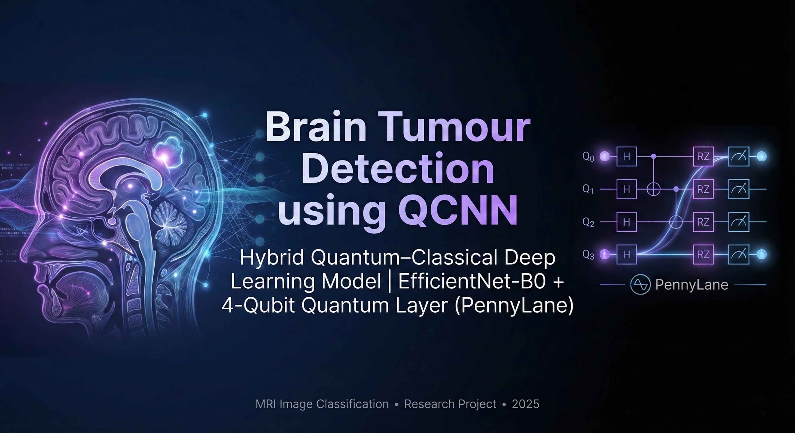
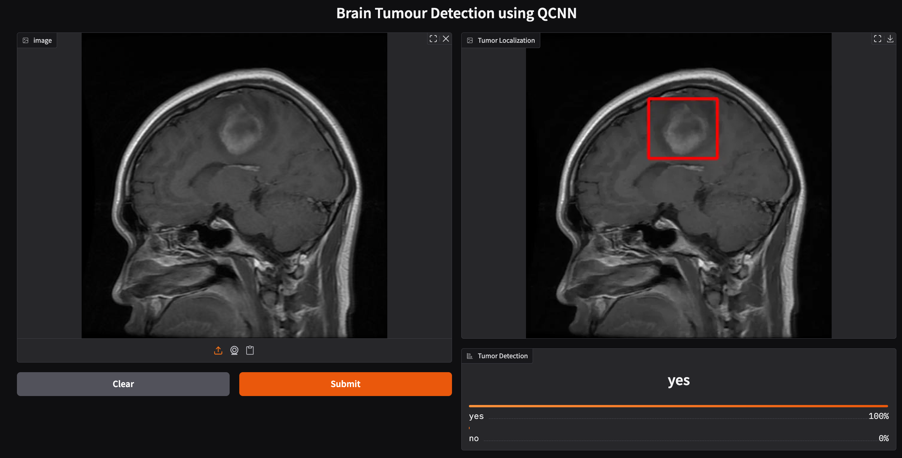

<p align="center">
  
</p>

<p align="center">
  
  
  
  
  
  
</p>

# Brain Tumour Detection using Quantum Convolutional Neural Networks (QCNN)

## Overview

This project demonstrates a hybrid quantum-classical deep learning model for brain tumour classification using MRI images. The architecture uses EfficientNet-B0 combined with a 4-qubit quantum variational layer.

---

## Motivation

Accurate brain tumour classification from MRI scans can support medical image analysis and research. This project explores a hybrid approach that combines classical convolutional feature extraction with a small quantum variational layer to investigate classification performance on medical images.

---

## Features

- Hybrid QCNN architecture (EfficientNet-B0 + Quantum Layer)
- Binary brain tumour classification
- Quantum circuit built using PennyLane
- Gradio UI for predictions
- Model checkpoint management
- GPU support

---

## Key Performance Highlights

- Binary MRI tumour classification
- Quantum variational layer for feature transformation
- EfficientNet-B0 for spatial feature extraction
- Training monitored using loss convergence
- GPU support for faster computation
- Predictions for both *tumour* and *no tumour* classes
- Lightweight architecture suitable for experimentation and deployment

---

## Tech Stack

### Deep Learning
- PyTorch
- EfficientNet-B0

### Quantum Computing
- PennyLane
- Strongly Entangling Layers (4-qubit)

### Utilities
- NumPy
- Pillow
- Scikit-learn
- Torchvision
- Gradio

---

## Dataset

The dataset is available on Kaggle:

https://www.kaggle.com/datasets/skarthik112/karthik-braindataset-mri

### Folder Structure

```text
brain_Tumor_karr/
├── yes/    → Tumour present
└── no/     → No tumour
```

---

## Classification Report

| Class | Precision | Recall | F1-Score |
|---|---:|---:|---:|
| Yes (Tumour) | 0.98 | 0.97 | 0.98 |
| No (Normal) | 0.99 | 0.99 | 0.99 |

**Overall Accuracy:** 0.996

*Note: Verify these metrics against the actual evaluation results before presenting them as achieved results.*

---

## Sample Results

### Tumour Detected (YES)



### No Tumour (NO)


---

## Repository Structure

```text
Brain-Tumor-QCNN/
│
├── train_qcnn.py
├── predict_qcnn.py
├── README.md
├── requirements.txt
├── .gitignore
│
└── assets/
    ├── yes_result.png
    └── no_result.png
```

---

## Author

**Harshitha**

Brain Tumour Detection using Quantum Convolutional Neural Networks (QCNN)

---

## Installation

### 1. Install Dependencies

```bash
pip install -r requirements.txt
```

### 2. Prepare the Dataset

Download the dataset from Kaggle:

https://www.kaggle.com/datasets/skarthik112/karthik-braindataset-mri

Arrange the dataset in the folder structure described above.

### 3. Train the Model

```bash
python train_qcnn.py
```

### 4. Run the Gradio Prediction App

```bash
python predict_qcnn.py
```

---

## Usage

1. Install the required dependencies.
2. Download and prepare the MRI dataset.
3. Train the model using `train_qcnn.py`.
4. Run `predict_qcnn.py` to launch the prediction interface.
5. Upload an MRI image to obtain a model prediction.

---

## Disclaimer

This project is intended for educational and research purposes only. Its predictions should not be used as a substitute for professional medical diagnosis.
